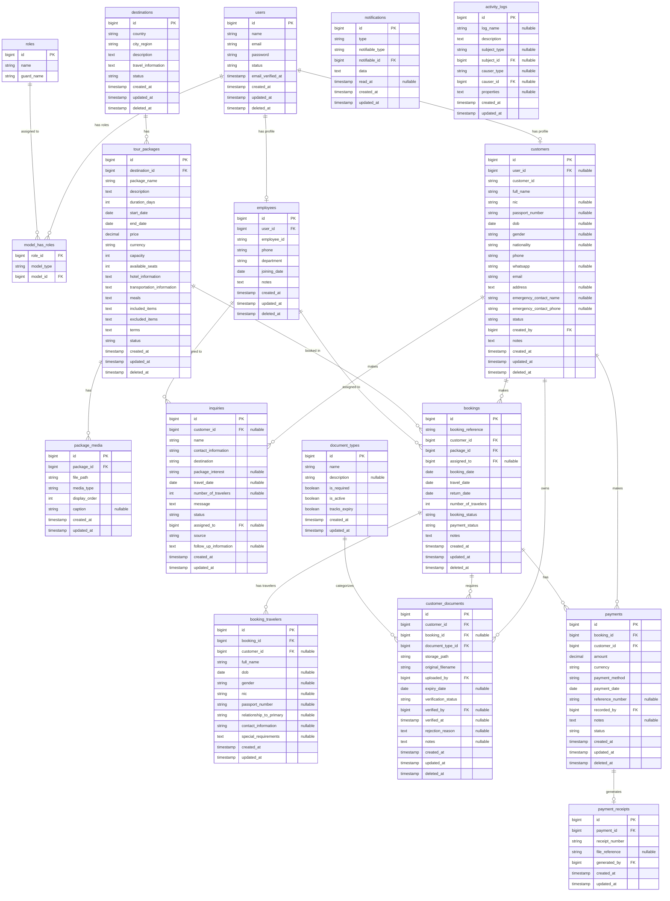

# Nisala Travels - Entity Relationship Diagram

The following diagram illustrates the relational database architecture for the Nisala Travels Management System. It encompasses Authentication, RBAC, CRM, Tour Management, Booking, Payments, and Document Management.

